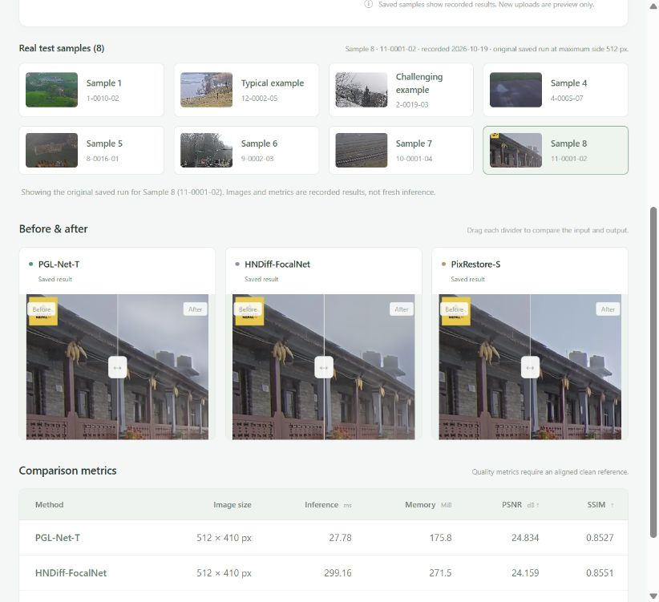

# ROAS5800作业-image dehzing

**Local image dehazing with three recent pretrained methods, an English Gradio interface, and a reproducible RW2AH test comparison.**

**Website:** [Open the image-dehazing UI](https://zhangyicristino.github.io/ROAS5800-image-dehzing/)

This ROAS5800 Assignment 1 project integrates [PGL-Net-T](https://github.com/sc-30-bit/PGL-Net), [HNDiff-FocalNet](https://github.com/Jin-Ting-He/HNDiff), and [PixRestore-S](https://github.com/csslc/PixRestore). Project contributions are the common inference adapters, interactive UI, shared evaluation protocol, and measured comparison. The underlying algorithms and pretrained weights belong to their authors; no model is trained here.



The screenshot shows the single-page website UI in `site/`. It includes eight real saved test examples, each with its processed hazy input, clean reference, three model outputs, original measurements, and a downloadable ZIP. The complete 352-pair numerical results and provenance are also included. Model code, weights, and the remaining dataset/output images are prepared locally using the steps below.

## Single-page website

Use the [public GitHub Pages website](https://zhangyicristino.github.io/ROAS5800-image-dehzing/), or preview it locally:

Run this from the repository root with Python installed:

```powershell
python -m http.server 8765 --bind 127.0.0.1 --directory site
```

Open **http://127.0.0.1:8765/**. The first example loads automatically. Click any of the eight sample thumbnails to switch the real input, three before/after comparisons, measurements, and download ZIP.

This static UI displays results from the original completed evaluation; choosing a saved example does not run a model. Uploading a new image shows an input preview and clears the saved outputs and measurements. New-image inference is available in the local Gradio app below and has not been connected to this website. The `Deploy GitHub Pages` workflow publishes changes to `site/` from `main`.

## Measured results

All **352 paired test images** from the [RW2AH release](https://github.com/fiwy0527/AAAI25_SGDN) were evaluated on an **RTX 4060 Laptop GPU (8 GB)** on 19 October 2026. Inputs share an aspect-preserving maximum side of 512 pixels. Quality uses the first saved uint8 RGB output; timing uses three forwards per image, followed by the dataset median.

| Method | Mean PSNR (dB) ↑ | Mean SSIM ↑ | Mean MAE ↓ | Median GPU forward (ms) ↓ | Peak allocated (MiB) | Loaded parameters (M) |
| --- | ---: | ---: | ---: | ---: | ---: | ---: |
| Untreated | 19.01 | 0.5817 | 0.0991 | — | — | — |
| PGL-Net-T | **22.82** | 0.6489 | **0.0619** | **28.17** | 175.8 | 0.78 |
| HNDiff-FocalNet | 22.36 | **0.6640** | 0.0655 | 247.89 | 271.5 | 14.42 |
| PixRestore-S | 18.60 | 0.5706 | 0.1025 | 69.59 | 314.3 | 53.70 |

PGL-Net-T had the highest mean PSNR and shortest median forward time; HNDiff had the highest mean SSIM. PixRestore-S performed below untreated inputs on this dataset and protocol. These are local measurements of the released systems, with different training data and inference precisions. They do **not** establish a global SOTA ranking or reproduce the papers' original evaluation settings.

- [Full precision summary](results_full/summary.csv), [per-image measurements](results_full/per_image.csv), and [original validation record](results_full/validation.json).
- [Protocol, checkpoint differences and limitations](docs/REPRODUCIBILITY.md).
- [Chinese reference report](report/reference_report.md), [English report text](report/report_en.md), and [presentation outline](presentation/slides.md).

## Quick start on Windows

The tested environment is Windows, Python **3.12.10**, PyTorch **2.8.0+cu128**, and an RTX 4060 Laptop GPU with approximately 16 GB system RAM. An NVIDIA GPU is recommended. The backend can fall back to CPU, but CPU inference performance has not been benchmarked. Keep enough disk space for dependencies and, optionally, the dataset and saved outputs.

```powershell
git clone https://github.com/zhangyiCristino/ROAS5800-image-dehzing.git
cd ROAS5800-image-dehzing
powershell.exe -NoProfile -ExecutionPolicy Bypass -File .\setup.ps1
.\.venv\Scripts\python.exe scripts/prepare_assets.py
.\run.ps1
```

`setup.ps1` creates a local virtual environment and installs the pinned dependencies. `prepare_assets.py` downloads the required model definitions and approximately 268 MiB of pretrained assets from the original sources, then checks their size and SHA-256. It reuses files that already match. Read [third-party notices](THIRD_PARTY_NOTICES.md) before using the downloaded materials. If an author removes a file or changes it, preparation fails instead of silently substituting a different model.

Open **http://127.0.0.1:7860**. On a fresh clone, choose **Single-image comparison**, upload a hazy RGB photo, select methods, and click **Compare methods**. A same-size aligned clean reference is optional; quality metrics appear only with that reference. The output ZIP contains the processed input, restored images, metrics, and run settings. Inference runs locally without a cloud API.

The **Full test results** image browser needs a locally completed evaluation and its saved images. The GitHub copy contains the reference CSV/summary, so that browser becomes available after the full workflow below. The UI does not present missing or incomplete image outputs as a completed local run.

## Reproduce the complete evaluation

Run from the repository root after preparing the environment and model assets:

```powershell
# Fetch all 352 aligned test pairs from the author-linked archive; no training images.
.\.venv\Scripts\python.exe scripts/prepare_dataset.py --count 352 --output-dir data/rw2ah_test352 --manifest data/manifest_full.json --budget-mb 700 --workers 4

# Run the three methods sequentially at the recorded settings.
.\.venv\Scripts\python.exe -m dehaze.evaluation --manifest data/manifest_full.json --output results_full --max-side 512 --runs 3 --seed 0

# Check input hashes, saved output pixels, sampled metrics and all summary means.
.\.venv\Scripts\python.exe scripts/validate_results.py
```

Evaluation writes fresh measurements into `results_full/`, including `evaluation.json`, completion status, and saved PNGs. It replaces the checked-in reference summary/CSV in your working copy. Keep a copy of those files if you want to compare runs. Click **Refresh results** in the UI after evaluation finishes. Do not run UI inference concurrently with timed evaluation.

For a smaller first check and optional UI examples:

```powershell
.\.venv\Scripts\python.exe scripts/prepare_dataset.py --count 12 --budget-mb 100
.\.venv\Scripts\python.exe -m dehaze.evaluation --manifest data/manifest.json --output results_pilot --max-side 512 --runs 3 --seed 0
```

This 12-pair subset is only a smoke test; the published table uses all 352 pairs. The dataset downloader uses bounded HTTP Range requests and reuses verified files. Author-hosted downloads require internet access and may be affected by service availability.

## Checks

```powershell
.\.venv\Scripts\python.exe scripts/prepare_assets.py --verify-only
.\.venv\Scripts\python.exe -m unittest discover -s tests -v
```

CPU tests check image preprocessing, model-cache/seed contracts, asset integrity behavior, and rejection of incomplete or inconsistent saved benchmarks. A test for the actual full image browser is skipped until its local evaluation images exist. These tests do not substitute for pretrained GPU evaluation.

The [publication check record](docs/PUBLICATION_CHECKS.json) also records a small-image inference check of all three models after asset preparation.

## Project layout

```text
app.py                       English Gradio UI and comparison export
site/                        Single-page website UI and eight saved comparisons
dehaze/                      Inference adapters, metrics and saved-results reader
scripts/prepare_assets.py    Download and verify official model assets
scripts/prepare_dataset.py   Prepare author-linked RW2AH test pairs
scripts/validate_results.py  Independently check completed local evaluations
assets.json                  Exact runtime asset hashes and download mapping
data/manifest*.json          Test pair names, source metadata and hashes
results_full/                Published numerical results and audit records
report/                      Chinese and English reference report text
presentation/                Slide outline and speaker notes
docs/                        Reproduction details and English UI screenshot
third_party/                 Original local provenance manifest
```

Downloaded `third_party/` code, `checkpoints/`, the complete dataset/output collections, virtual environments, logs, and general archives are ignored by Git. The eight processed example groups and their comparison ZIPs in `site/samples/` are included. The original course PDF/PPT and complete submission archive remain local.

## Relation to Physical AI

Dehazing can be studied as preprocessing for outdoor robot perception or Real-to-Sim scene reconstruction. This assignment evaluates image restoration only. A future extension would hold feature matching or reconstruction settings fixed, compare raw versus dehazed inputs, and measure downstream geometry or task performance; no such gains are claimed here.

## Attribution and use

- PGL-Net: [paper](https://arxiv.org/abs/2606.25732), [official repository](https://github.com/sc-30-bit/PGL-Net).
- HNDiff: [paper](https://arxiv.org/abs/2608.10995), [official repository](https://github.com/Jin-Ting-He/HNDiff).
- PixRestore: [paper](https://arxiv.org/abs/2608.16793), [official repository](https://github.com/csslc/PixRestore), [official weights](https://huggingface.co/VCLab-PolyU/PixRestore).
- DINOv2: [paper](https://arxiv.org/abs/2304.07193), [official repository](https://github.com/facebookresearch/dinov2).
- RW2AH: [paper](https://arxiv.org/abs/2412.17496), [dataset authors' repository](https://github.com/fiwy0527/AAAI25_SGDN).

See [THIRD_PARTY_NOTICES.md](THIRD_PARTY_NOTICES.md) for the observed license status of each source. No blanket project license is assigned in this repository; publication does not grant additional rights to the authors' code, checkpoints, or imagery. The report and slide text are editable references for understanding and revision; course submission rules still apply.
