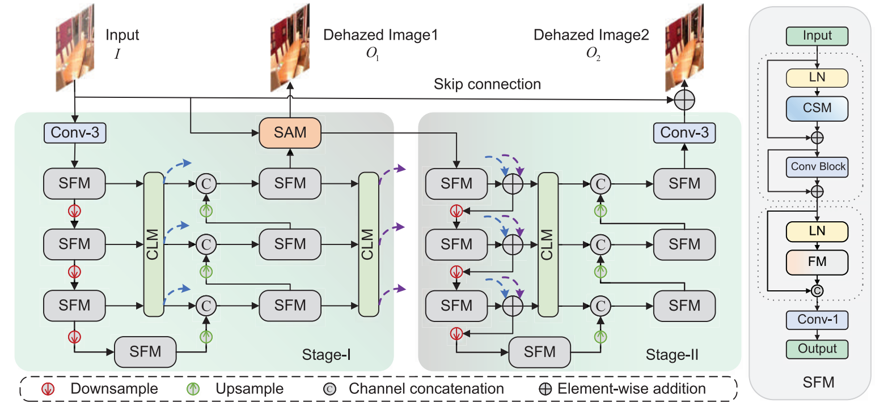
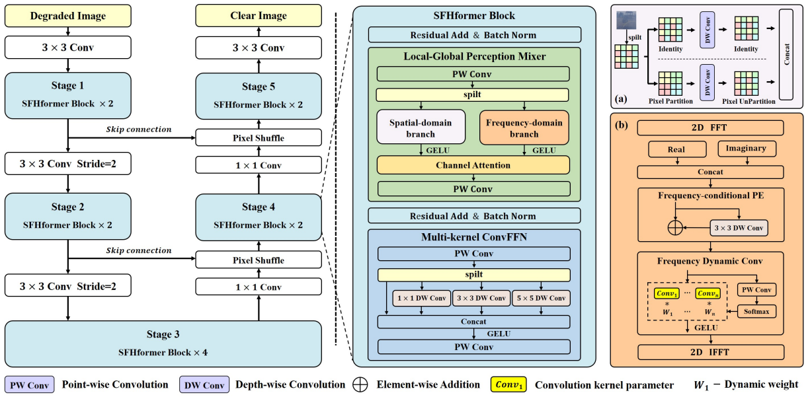
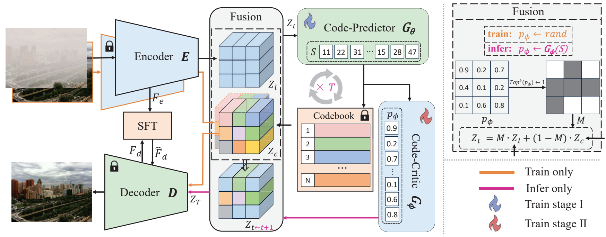

# 从零理解本次图像去雾作业

这份讲解配套 ROAS 5800 Assignment 2。正式报告为英文两页 PDF，PPT 是英文页面，备注含英文五分钟讲稿与中文补充讲解。本文件用中文解释背景、三种方法、真实实验和汇报思路。

## 1. 这次究竟做了什么

任务是给电脑一张有雾照片，让深度学习模型输出同一场景的清晰照片。比较的方法是 **SFMN、SFHformer、IPC-Dehaze**，均使用作者公开的预训练权重。

本机执行了模型加载、完整推理、保存图片、逐图评价和结果核验。SFMN 的两个阶段全部运行；IPC-Dehaze 的预测器、评价器和八轮迭代全部保留。这次没有重新训练模型。

测试使用 RW2AH 全部 **352 对测试图**，每张有雾图都有同尺寸清晰参考，全部保持 **640×512** 原始分辨率。三种方法每张图各运行三次，共 3,168 次计时前向，另有预热。保存的恢复图共 **1,056 张**，质量指标使用第一次运行保存的图像。

Assignment 1 使用过 PGL-Net-T、HNDiff-FocalNet、PixRestore-S，本次选题避开这三篇。SGDN 只作为数据集来源引用，没有作为第四种被调研算法。课堂讲义未提供，讲义中的论文排重仍应由你核对。

## 2. 为什么照片会发灰

空气中的粒子散射光线。到达相机的光包含场景本来的信息，也包含环境光的干扰。一个常用简化公式是：

$$I(x)=J(x)t(x)+A[1-t(x)]$$

| 符号 | 直观含义 |
|---|---|
| $x$ | 图像中的一个位置 |
| $I$ | 相机拍到的有雾图，已知 |
| $J$ | 希望恢复的清晰场景，未知 |
| $t$ | 透射率，表示场景光保留了多少 |
| $A$ | 环境光，简化模型中通常视为全局量 |

用一个灰度数值举例：清晰像素 $J=40$、环境光 $A=200$、透射率 $t=0.4$，相机得到 $I=40×0.4+200×0.6=136$。原来暗的物体被抬亮，画面变灰。这只是解释原理的数值例子，不是实验测量。

实际输入中只有 $I$ 已知，多组 $J,t,A$ 都可能得到相似的 $I$，因此去雾需要额外知识，也就是“先验”。深度学习把训练图像中的规律编码进网络权重。

## 3. 先分清训练、权重和推理

**训练**是在很多例子上调整网络参数。**权重**是训练后的参数文件，类似已经学到的经验。**推理**是固定这些参数，处理一张新图。本次采用作者已经训练好的模型，电脑负责运行和评价。

一张 RGB 图有红、绿、蓝三个通道。PNG 中每个通道通常用 0–255 的整数表示。进入本次模型前除以 255，变成 0–1 的浮点数。模型输出后裁到 0–1，再乘 255、四舍五入，保存成 RGB PNG。所有质量分数都针对这些实际保存的像素计算。

为适应网络的下采样和窗口，输入右边与下边补镜像像素。三个方法都采用同一套补边，计算完去掉补边，参与比较的内容仍是原来的 640×512。这里没有把图片缩小来降低显存。

## 4. 空间域、频域是什么

空间域就是直接看每个位置及其邻居的颜色。卷积可以理解为一个小窗口在图上移动，学习提取边缘、纹理和局部模式。

频域换一种方式表示图像：把不同尺度的变化分开观察。FFT 是快速傅里叶变换，逆 FFT 把频域表示变回空间表示。大范围平滑变化、细密纹理会在不同频率上体现。

频谱包含**幅度**与**相位**。幅度与各频率成分的强弱有关，相位与这些成分如何排列有关；两者共同决定图像。把“幅度对应亮度、相位对应结构”当作入门提示即可，它不是一条严格的一一对应规则。网络也常对中间特征做 FFT，而不只是对原始照片做变换。

“全局信息”表示一个位置能够利用图像远处的线索，例如大片天空或远处建筑的整体退化。“局部信息”强调边缘和细节。三种方法的主要区别，是如何获取并使用这些线索。

## 5. SFMN：两阶段处理空间与频谱

论文：Shen 等，*Spatial Frequency Modulation Network for Efficient Image Dehazing*，IEEE TIP，2025。

SFMN 使用两套衔接的 U-Net。U-Net 先降低分辨率汇总信息，再恢复分辨率，并把较早的细节传到后面的层。第一阶段输出的频谱幅度与输入相位结合形成中间图，第二阶段继续恢复结构。

三个缩写可以这样记：CSM 汇集不同尺度，FM 调制频域特征，CLM 连接不同层级。“调制”就是用一组特征控制另一组特征的强弱。

它的动机是用较小模型获取更充分的上下文。代价是两个阶段都要计算，且训练数据的规律可能难以覆盖真实雾。原图如下，主要看 Stage-I、Stage-II 与跨层连接即可：



## 6. SFHformer：局部卷积配合频域特征

论文：Jiang 等，*When Fast Fourier Transform Meets Transformer for Image Restoration*，ECCV，2024。

SFHformer 把空间分支和频域分支融合。空间分支处理多尺度局部关系；频域分支执行 FFT、位置编码和动态卷积，再变回空间域。多核 ConvFFN 让网络观察不同大小的局部区域。

可以把它理解为同时用“放大镜”和“全景视角”处理图像。这只是帮助理解分工的比喻。局部与频域模块都要消耗计算，而且效果依赖训练分布。

本机严格加载的官方去雾发布配置有 **4.75M 参数**。论文表中写的是 **3.87M**，两者存在配置差异。报告分别标明论文结果和本机发布模型结果。



## 7. IPC-Dehaze：先提出代码，再评价和修改

论文：Fu 等，*Iterative Predictor-Critic Code Decoding for Real-World Image Dehazing*，CVPR，2025。

模型先通过 VQGAN 学到清晰图像的“码本”。可以把码本想成一个有限的图像特征词典。编码器把输入转换为特征，Code-Predictor 给各位置提出代码，Code-Critic 检查代码的关系，选出需要重新采样的位置。经过八轮，解码器用代码恢复图像。

这里的“代码”是图像特征的离散编号，不是 Python 源程序。评价器也不是人类审稿人，而是另一个神经网络。

论文使用 DIV2K、Flickr2K 的高质量图像学习码本，再用 RIDCP 的合成配对流程训练预测器和评价器。“面向真实场景”描述目标应用，不表示训练使用了配对真实雾照片。三种方法的合成流程与目标函数不同，比较时应保留这个背景。

生成式先验有助于得到看起来清楚的图像，但可能改变颜色和细节；多轮计算也增加延迟。每次计时前都把随机种子设为 0，本机三次量化输出一致。相同种子不保证不同硬件、不同软件版本之间也逐位一致。



## 8. 为什么论文里的高分不能直接放到本机表里

论文各自选择训练数据、测试集、分辨率和评价实现。SFMN 在 SOTS-Outdoor 报告 **37.72 dB / 0.991**，SFHformer 报告 **38.83 dB / 0.9951**。对应的 SOTS-Indoor 数字分别为 **41.44 / 0.995** 和 **43.03 / 0.9966**。

IPC-Dehaze 在 RTTS 报告 **MUSIQ 59.60、TOPIQ 0.500**。这两种是无需清晰参考图的感知评价，不是 PSNR/SSIM。各论文的数字用于说明论文自身证据，不能直接合并成一张共同排行榜。

本机统一在 RW2AH 上测试，前两种使用作者的 OTS 合成室外权重，第三种使用其真实场景发布权重。因此本次是发布模型的真实雾泛化与部署比较，训练数据和训练预算没有被统一。

这些论文在发表时报告了先进结果或质量与效率的优势。“SOTA”应带上数据集、指标和配置范围。一次测试不足以支持“所有场景都第一”的说法。

## 9. 看懂 PSNR、SSIM、耗时和显存

**PSNR** 比较输出与清晰参考的逐像素误差。误差越小，分数越高，单位是 dB。它非常在意颜色、亮度与对齐。一个看起来清楚但整体偏色的结果，PSNR 仍可能下降。

$$\mathrm{PSNR}=10\log_{10}\frac{255^2}{\mathrm{MSE}}$$

MSE 是所有 RGB 像素的平均平方误差。本次先对每张图计算 PSNR，再平均 352 个分数。先平均所有误差再取对数，会得到另一种汇总口径。

**SSIM** 比较局部亮度、对比和结构关系，越高通常越好，但同样不是人眼判断的完整替代。这里采用固定 11×11 高斯窗口、RGB 三通道评价，不换成亮度通道，也不裁去边缘。

**GPU 前向耗时**只统计模型计算。每张图测三次取中位数，然后对 352 张图的中位数再取中位数。首次加载、文件读写和图像传输不在这个数字中，所以它小于完整使用流程的等待时间。

**显存峰值**是 PyTorch 张量分配的峰值，包含已加载模型与输入等张量。MiB 等于 $2^{20}$ 字节。驱动、其他程序和系统显示占用并未全部包含，因此这个数字与任务管理器显示不同。

## 10. 本机完整测试结果

硬件：RTX 4060 Laptop 8GB、Ryzen 9 7845HX、约 15.2GiB 系统可用内存。软件：Windows、PyTorch 2.8.0+cu128。全部 FP32、批量 1、关闭 TF32，每次只加载一种模型。

| 方法 | PSNR ↑（dB） | SSIM ↑ | GPU 前向中位数（ms） | 显存峰值（MiB） |
|---|---:|---:|---:|---:|
| Hazy input | 18.62 | 0.5564 | — | — |
| SFMN | 18.32 | 0.5561 | 241.3 | 1553 |
| SFHformer | 18.37 | 0.5553 | 505.2 | 586 |
| IPC-Dehaze | 13.21 | 0.4918 | 5379.7 | 849 |


输入本身也参加评价，作为基准。每张图相对输入提高 PSNR 的数量为：**SFMN：165/352、SFHformer：171/352、IPC-Dehaze：41/352**。有些场景改善，并不保证整个测试集的平均分也提高。

英文报告的结果描述是：All three releases reduced mean PSNR relative to the hazy-input baseline. SFHformer obtained the highest restored-image mean PSNR (18.37 dB), 0.25 dB below the hazy-input baseline (18.62 dB). SFMN had the lowest median GPU forward time (241.3 ms). All three completed the full test within 8GB device capacity.

颜色变化、局部细节改变和训练分布差异都值得检查。当前实验没有通过重新训练或消融来逐一分离这些因素，解释原因时应使用“可能”“提示”等措辞。

两组展示图依据输入 PSNR 排序的 25% 与 75% 位置选择，不按任何模型的最佳表现筛选。具体编号是 **1-0125-06** 和 **8-0121-02**。完整结论使用全部 352 对图，而非这两张展示图。

## 11. 在哪里查看证据、怎样复查

- `experiments/rw2ah_full/summary.csv`：完整结果汇总。
- 各模型子目录下的 `per_image.csv`：每张图的指标、时间和输出哈希。
- 各模型子目录下的 PNG：实际保存的恢复图，共 1,056 张。
- `protocol.json`：补边、精度、指标、计时口径。
- `hardware.json`：本机环境。
- `independent_validation.json`：对全部输出独立重算指标后的核验记录。
- `sources/`、`checkpoints/`：官方源码快照和所需权重；来源与 SHA-256 已记录。

如果要在当前电脑重新完整运行，打开 PowerShell：

```powershell
cd D:\roas5800\hw2
& 'D:\roas5800\.venv\Scripts\python.exe' -m dehaze.evaluate --output experiments/rw2ah_repeat
```

上述命令使用新的结果目录，不覆盖当前正式实验。原始数据仍位于 `D:\roas5800\hw1\data\rw2ah_test352`，本次只复用了测试数据，并未复用 Assignment 1 三种模型的输出。

## 12. 使用交互式界面

[项目首页](https://zhangyicristino.github.io/ROAS5800-image-dehzing/) 提供 Assignment 1 / Assignment 2 两个入口。作业 1 保留旧的三种方法，作业 2 展示本次的 SFMN、SFHformer、IPC-Dehaze。两次作业分别保存自己的图像尺寸与测量口径。

公开网页可以点击真实样例、选择方法、拖动前后对比滑块、查看单图及完整测试结果，并下载样例 ZIP。网页上上传新图片会清空旧结果并显示输入预览。处理新图片需要启动本机应用。

在当前电脑双击仓库里的 `启动Assignment2.bat`，或在仓库目录运行 `run_assignment2.ps1`，打开 **http://127.0.0.1:7861**。作业 1 保留原来的 7860 端口。

1. 上传有雾图片，也可以点击测试图缩略图载入。
2. 可选上传同尺寸清晰参考；没有参考时只显示输出与运行成本。
3. 选择要运行的方法与最大边长，点击 **Compare methods**。
4. 等待真实 GPU 推理完成，拖动三张结果的滑块观察变化。
5. 下载 ZIP，查看输入、输出、指标和本次设置。

**Full test results** 标签页浏览完整 352 对已保存结果，不会重新运行模型。完整测试正在计时时，应用会阻止新推理；测试完成后点击刷新即可加载全部记录。单张图片页面的时间是一次前向，完整测试表是三次重复后的中位数。

## 13. 五分钟汇报怎么讲

| 页 | 时间 | 要说清楚的事情 |
|---|---:|---|
| 1 | 15 秒 | 研究任务、三种方法、本机评价 |
| 2 | 35 秒 | 去雾公式、问题歧义与相关工作方向 |
| 3 | 35 秒 | SFMN 的两阶段与跨尺度调制 |
| 4 | 35 秒 | SFHformer 的局部与频域融合 |
| 5 | 40 秒 | IPC-Dehaze 的码本、评价器和八轮迭代 |
| 6 | 25 秒 | 论文结果来自不同评价口径 |
| 7 | 50 秒 | 352 对完整本机结果及公平比较边界 |
| 8 | 40 秒 | 展示真实输出，解释清晰度与参考保真度 |
| 9 | 25 秒 | 局限与未来工作 |
| 10 | 不计入口头讲述 | 参考文献附页 |

合计目标 300 秒。PPT 备注先给出英文口头讲稿，再提供中文理解与问答资料。英文稿约按每分钟 125 个词估算，需要你实际练习一次；中文补充不需要在五分钟内逐字朗读。讲数字时抓住结果排序、相对输入的变化和耗时差异即可，不必把整张表读一遍。

## 14. 常见提问

**你训练了这三个模型吗？** 本次使用官方预训练权重，完成本机完整推理和全测试集评价。训练流程来自论文调研，不能把作者训练时间算作本机实测。

**为什么不直接用 Assignment 1 的模型？** Assignment 2 限制使用已经介绍过的论文，因此更换为另外三篇。

**为什么论文分数高，真实雾图却可能不提升？** 测试集、训练分布、评价口径和发布配置不同。单个数据集上的结果不能保证跨场景保持相同排序。

**去雾结果看起来更清楚，为什么分数下降？** PSNR/SSIM 关注与给定参考的接近程度。亮度、颜色或纹理改变可以增加观感上的对比，同时扩大参考误差。

**能说谁最适合自动驾驶吗？** 目前只测试图像恢复，没有测目标检测、距离估计或视频稳定性。要回答自动驾驶收益，需要额外的下游任务实验。

**8GB 显存可以处理任意大图吗？** 这次验证的是批量 1、640×512、指定 FP32 配置。更大尺寸、批量或训练会需要另外评估。

**这些参考图一定等于现实中的唯一正确答案吗？** 它们是数据集提供的配对参考，可用于统一评价。不同真实拍摄条件也可能影响像素差异，因此应结合输出图与数据集边界解释分数。

## 15. 原始资料

1. [SFMN 官方论文](https://www.haoshen.site/resources/ShenHao_SFMN_TIP_2025.pdf) · [官方代码与权重](https://github.com/it-hao/SFMN)。
2. [SFHformer ECCV 论文](https://www.ecva.net/papers/eccv_2024/papers_ECCV/papers/06190.pdf) · [官方代码与权重](https://github.com/deng-ai-lab/SFHformer)。
3. [IPC-Dehaze CVPR 论文](https://openaccess.thecvf.com/content/CVPR2025/papers/Fu_Iterative_Predictor-Critic_Code_Decoding_for_Real-World_Image_Dehazing_CVPR_2025_paper.pdf) · [官方代码](https://github.com/Jiayi-Fu/IPC-Dehaze)。
4. [RW2AH 数据集作者项目](https://github.com/fiwy0527/AAAI25_SGDN)。

图像来源分别为三篇论文的 Fig.3、Fig.2、Fig.2；图中原始模块和图例均保留。解释性比喻是本讲解为入门阅读添加的辅助说明。
